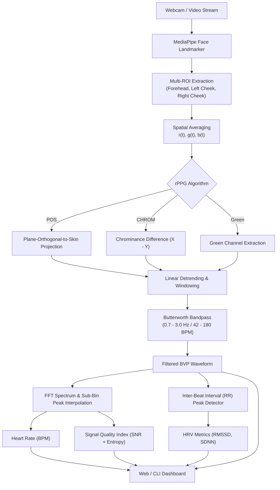

# Remote Heart Rate Measurement (rPPG)

[](https://habom2310.github.io/Heart-rate-measurement-using-camera/)
[](LICENSE)
[](https://react.dev)
[](https://www.typescriptlang.org)
[](https://www.python.org)
[](https://vitejs.dev)

---

## 🌐 Live Web Demo

### 👉 [**Open Live Application: habom2310.github.io/Heart-rate-measurement-using-camera**](https://habom2310.github.io/Heart-rate-measurement-using-camera/)

> **Instant Zero-Install Telemetry:**
> * 📱 **Works on Mobile & Desktop**: Open in Safari, Chrome, or Edge on iPhone, Android, or laptop.
> * 🔒 **100% Local & Private**: Camera frames never leave your browser. MediaPipe WASM and Web Workers process all telemetry locally.
> * ⚡ **Synthetic Mode Available**: Built-in 72.0 BPM simulation allows full testing even without a webcam.

---

A modern, high-precision remote photoplethysmography (rPPG) suite that measures heart rate (BPM) and heart rate variability (HRV) contactlessly from facial video. Features a zero-install client-side **Web Application** and a high-performance **Python CLI & SDK**.

---

## ✨ Features

- **Real-Time Client-Side Web App**: Runs entirely inside modern web browsers using React 19, TypeScript, Tailwind CSS, and MediaPipe Face Mesh. Zero video data leaves the local device.
- **High-Performance 60 FPS Visualizations**: Hardware-accelerated HTML5 Canvas Oscilloscope rendering real-time pulse waveforms, moving averages, and FFT frequency power spectrum.
- **Robust rPPG Algorithms**:
  - **POS (Plane-Orthogonal-to-Skin)**: State-of-the-art motion-resistant projection orthogonal to the skin-tone vector.
  - **CHROM (Chrominance-Based)**: Normalized color-difference formulation cancelling specular reflection artifacts.
  - **Green Channel**: Classical high-SNR baseline signal extraction.
- **Signal Quality Index (SQI)**: Real-time confidence score combining peak-to-noise ratio (SNR), spectral entropy, and motion detection with alert indicators.
- **Heart Rate Variability (HRV)**: Dynamic peak detection estimating inter-beat intervals (RR) and time-domain metrics:
  - **RMSSD**: Root mean square of successive differences.
  - **SDNN**: Standard deviation of NN intervals.
  - **Mean RR**: Average interval between successive heartbeats.
- **Live Eulerian Color Magnification**: Amplifies subtle micro-vascular blood perfusion pulses in skin color.
- **Instant Data Export**: One-click export of session metrics, raw RGB signals, filtered pulse traces, and timestamped RR intervals to CSV or JSON formats.
- **Modern Python CLI & Library (`rppg`)**: Clean, typed Python pipeline supporting live webcams, recorded video files, custom ROIs, and batch analysis.

---

## 🚀 Quickstart

### 1. Online Demo (Zero-Install)

Launch the deployed app directly on any mobile phone or computer:
👉 **[https://habom2310.github.io/Heart-rate-measurement-using-camera/](https://habom2310.github.io/Heart-rate-measurement-using-camera/)**

---

### 2. Local Web Development

Run the client-side web application locally:

```bash
# Navigate to web directory
cd web

# Install dependencies
npm install

# Start development server
npm run dev
```

Open [http://localhost:5173](http://localhost:5173) in your web browser, grant webcam access, and position your face within the guide oval.

#### Convenient Python Launcher
You can also launch or serve the web build using the included Python helper:

```bash
# Serve production build on http://localhost:8000
python scripts/run_web.py

# Or launch Vite dev server
python scripts/run_web.py --dev
```

### 3. Python CLI & Library

Install the Python package locally in editable mode:

```bash
# Install package and dependencies
pip install -e .

# Run real-time rPPG on primary webcam (device 0) using POS algorithm
rppg --source 0 --algo pos

# Run on a recorded video file with CHROM algorithm and save output
rppg --source path/to/video.mp4 --algo chrom --output results.csv
```

#### Eulerian Video Magnification Script
To run standalone Eulerian Video Magnification for color or motion pulses:

```bash
python scripts/amplify_color.py --source 0 --mode color --amplification 30.0
```

---

## 📐 System Architecture



---

## 🔬 Algorithms & Mathematical Foundation

### 1. Region of Interest (ROI) Selection
Skin color variations are extracted from three facial areas with high capillary density and minimal facial expression movement:
- **Forehead**: Upper facial quadrant above the brow line.
- **Left & Right Cheeks (Malar regions)**: Dense vascular beds with high micro-circulation visibility.

Pixel intensities within each ROI are spatially averaged per frame to suppress sensor quantization noise:
$$\bar{c}(t) = \frac{1}{|ROI|} \sum_{(x,y) \in ROI} I_c(x,y,t), \quad c \in \{R, G, B\}$$

### 2. rPPG Core Algorithms

#### Plane-Orthogonal-to-Skin (POS)
The POS method (Wang et al., 2017) defines a projection matrix in normalized RGB space that is orthogonal to the skin tone vector, making the pulse signal robust to intensity variations caused by motion:
1. Temporally normalize RGB channels by dividing by their temporal running means:
   $$c_n(t) = \frac{c(t)}{\mu_c}$$
2. Project normalized signals onto two orthogonal chrominance axes:
   $$S_1(t) = G_n(t) - B_n(t)$$
   $$S_2(t) = G_n(t) + B_n(t) - 2 R_n(t)$$
3. Combine the projections weighted by their standard deviations:
   $$h(t) = S_1(t) + \alpha S_2(t), \quad \alpha = \frac{\sigma(S_1)}{\sigma(S_2)}$$

#### Chrominance-Based (CHROM)
CHROM (de Haan & Jeanne, 2013) combines color difference signals to remove specular reflection artifacts:
$$X_s(t) = 3 R(t) - 2 G(t)$$
$$Y_s(t) = 1.5 R(t) + G(t) - 1.5 B(t)$$
$$h(t) = X_s(t) - \frac{\sigma(X_s)}{\sigma(Y_s)} Y_s(t)$$

#### Green Channel Baseline
Verkruysse et al. (2008) demonstrated that oxyhemoglobin ($\text{HbO}_2$) exhibits strong absorption in the green light spectrum (~520–580 nm), giving the green channel the highest blood volume pulse signal-to-noise ratio among RGB camera sensors.

### 3. Signal Processing & Peak Detection
- **Linear Detrending**: Removes low-frequency baseline wander caused by respiration and lighting drift.
- **Bandpass Filtering**: 4th-order Butterworth filter with cutoffs at 0.7 Hz (42 BPM) and 3.0 Hz (180 BPM).
- **Fast Fourier Transform (FFT)**: Computes power spectral density over a sliding window (e.g. 5–10 seconds).
- **Parabolic Sub-Bin Peak Interpolation**: Refines dominant peak resolution beyond the discrete FFT frequency bin spacing $\Delta f = \frac{f_s}{N}$:
  $$\delta = \frac{1}{2} \cdot \frac{P_{k-1} - P_{k+1}}{P_{k-1} - 2P_k + P_{k+1}}$$
  $$f_{\text{peak}} = (k + \delta) \cdot \frac{f_s}{N}$$
  $$\text{BPM} = 60 \cdot f_{\text{peak}}$$

### 4. Heart Rate Variability (HRV)
Inter-Beat Intervals (IBIs or RR intervals) are identified using adaptive peak detection on the filtered pulse waveform. From valid consecutive intervals $\Delta t_i = t_{i+1} - t_i$:
- **RMSSD**:
  $$\text{RMSSD} = \sqrt{\frac{1}{M-1} \sum_{i=1}^{M-1} (\Delta t_{i+1} - \Delta t_i)^2}$$
- **SDNN**:
  $$\text{SDNN} = \sqrt{\frac{1}{M} \sum_{i=1}^{M} (\Delta t_i - \overline{\Delta t})^2}$$

---

## 📁 Repository Structure

```
.
├── assets/                     # Example results and images
├── pyproject.toml              # Modern Python package specification (PEP 621)
├── requirements.txt            # Python dependencies
├── scripts/
│   ├── amplify_color.py        # Standalone Eulerian Video Magnification
│   └── run_web.py              # Web app launcher & HTTP server
├── src/
│   └── rppg/                   # Python core package
│       ├── __init__.py
│       ├── cli.py              # CLI entrypoint (`rppg`)
│       ├── pipeline.py         # Streaming frame processing pipeline
│       └── core/
│           ├── algorithms.py   # POS, CHROM, and Green rPPG algorithms
│           ├── hrv.py          # HRV time-domain metric calculations
│           ├── roi.py          # Facial ROI extraction
│           ├── signal.py       # DSP filters, FFT, SQI
│           └── tracker.py      # Face landmark tracking
├── tests/                      # Python automated test suite
└── web/                        # React 19 + TypeScript web application
    ├── public/
    ├── src/
    │   ├── components/         # Dashboard, Canvas Oscilloscope, Gauge, Controls
    │   ├── lib/
    │   │   ├── algorithms/     # Client-side POS, CHROM, Green algorithms
    │   │   ├── dsp/            # TypeScript FFT, filtering, HRV, SQI
    │   │   └── vision/         # MediaPipe FaceLandmarker wrapper
    │   └── App.tsx
    ├── package.json
    └── vite.config.ts
```

---

## 📚 References & Academic Literature

1. **Wang, W., den Brinker, A. C., Stuijk, S., & de Haan, G. (2017).**  
   *Algorithmic Principles of Remote PPG.* IEEE Transactions on Biomedical Engineering, 64(7), 1479–1491.  
   DOI: [10.1109/TBME.2016.2609282](https://doi.org/10.1109/TBME.2016.2609282)

2. **de Haan, G., & Jeanne, V. (2013).**  
   *Robust Pulse Rate from Chrominance-Based rPPG.* IEEE Transactions on Biomedical Engineering, 60(10), 2878–2886.  
   DOI: [10.1109/TBME.2013.2266196](https://doi.org/10.1109/TBME.2013.2266196)

3. **Verkruysse, W., Svaasand, L. O., & Nelson, J. S. (2008).**  
   *Remote plethysmographic imaging using ambient light.* Optics Express, 16(26), 21434–21445.  
   DOI: [10.1364/OE.16.021434](https://doi.org/10.1364/OE.16.021434)

4. **Wu, H.-Y., Rubinstein, M., Shih, E., Guttag, J., Durand, F., & Freeman, W. T. (2012).**  
   *Eulerian Video Magnification for Revealing Subtle Changes in the World.* ACM Transactions on Graphics (Proc. SIGGRAPH), 31(4), 1–8.  
   DOI: [10.1145/2185520.2185561](https://doi.org/10.1145/2185520.2185561)

---

## 📄 License

This project is licensed under the MIT License — see the [LICENSE](LICENSE) file for details.
